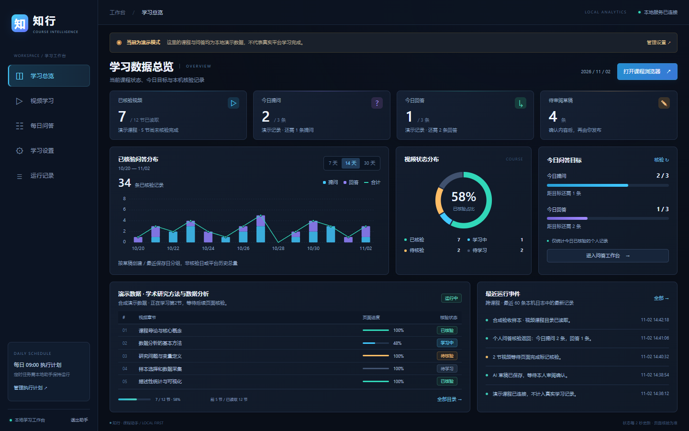

# 知行 · 课程助手

Windows 本地课程任务助手。将视频学习、每日问答草稿和结果核验放在一个可暂停、可追溯的界面里。

**0.1.2 评分细则导入预览版。演示课程及本地程序测试已通过；智慧树真实视频记分、个人记录完整性和真实发布尚未完成验收。请先体验演示模式。**

[下载 Windows x64 预览版](https://github.com/JamesMake520/course-study-assistant/releases/tag/v0.1.2)。解压后双击 `CourseStudyAssistant.exe`，首次使用可直接体验本地演示课程。



## 深色 BI 看板

总览采用深色背景、紧凑指标、图表和明细表。显示已核验课时、今日问答与目标、草稿状态以及本机运行记录。

- 未读取课程、尚未核验的问答显示“未知”，不以 0 或 100% 替代。
- 问答历史图按草稿日期统计当前课程配置下的本机记录，不等于当天平台实际核验次数或完整历史。
- 运行事件仅为本机最近 60 条，可能包含多个课程；不据此推算成功率或学习时长。
- 演示模式与真实平台持续显示明确标识。

## 开始使用

1. 解压 Windows 包，保持整个 `CourseStudyAssistant` 文件夹完整。
2. 双击 `CourseStudyAssistant.exe`，默认浏览器会打开本机控制台。
3. 首次保留“演示模式”，进入视频学习，点击“打开课程浏览器”，再读取课程并开始播放。
4. 演示课程包含两节 6 秒视频和示例问答；它们只保存在本机，不会访问或提交真实课程。
5. 每日问答可以手写草稿，也可以设置 AI 后起草。审阅并勾选确认后，才会执行发布。

## 导入评分细则

进入“评分细则”，粘贴课程考核原文，或选择 UTF-8 编码的 `.txt`、`.md`、`.json` 文件。点击解析后逐条核对任务条件、分数和计算方式，勾选确认并保存。已保存规则可导出 JSON，之后重新导入。

- 解析在本机运行，不使用 AI、不上传文件，不操作智慧树页面。截图和 PDF 暂不直接识别，请先复制文字。
- 能识别的中文句式转为草稿；歧义和未识别内容保留提示。原文仍保留，可手动修正或添加规则。不是任意自然语言的完整理解器。
- “每天 25 分钟、累计 12 天”是任务条件，不能据此猜分值；未明确的计分方式保留“待确认”。百分比权重不会在缺少课程总分时直接当作分值。
- 保存按当前课程配置隔离，并检查版本，防止另一窗口或另一课程的规则被误覆盖。导入失败不会替换已保存规则。
- 首页显示规则与目标分摘要。尚无对应平台进度证据时预计得分保持未知；已保存评分规则不代表已取得平台成绩，也不会自动改变每日执行计划。

详细流程见 [评分细则导入说明](docs/评分细则导入说明.md)。

如果此前已运行开发测试版，请先在旧控制台侧栏点击“退出助手”，再双击新版程序。重复启动会打开已运行的实例，不会同时抢占浏览器。

需要 Windows 10/11 x64 和已安装的 Microsoft Edge。打包版不需要安装 Python、Node 或 Codex；Edge 浏览器不包含在安装包中。工具仅监听本机随机端口，不能作为远程网站使用。

## 真实智慧树课程（实验性适配）

1. 在设置里选择“智慧树”，保存。可以填入自己课程与问答页面的 HTTPS 地址。
2. 点击“打开课程浏览器”，在新开的专用 Edge 窗口里自行登录。
3. 手动打开目标课程视频。如果课程在新标签页中打开，回到控制台点击“接管当前课程”。
4. 读取课程，核对名称与章节。只有识别到明确的页面证据时才会显示进度。
5. 开始播放后，遇到登录失效、验证码、弹题或无法识别的页面结构会暂停。页面显示完成才会计作平台已核验；播放结束本身不等于记分。
6. 每日问答先核对个人记录。无法证明当天记录完整时显示“未知”，阻止发布。回答必须指定问题链接；界面定位不唯一时停止，避免误投。

当前适配采用可见页面结构，平台改版或不同课程类型可能不匹配。没有伪造学习心跳、进度回传、跳过验证码或批量注册功能。课程测验和考试不属于此版本。

## AI 设置

填写自己的基础地址、模型和完整 API Secret Key，可选 Responses 或 Chat Completions 协议。远程地址必须使用 HTTPS，本机接口可用 HTTP。

- 连接测试与生成草稿会发送真实请求，可能消耗供应商额度；没有自动重试。
- 仅发送用户主动提供的材料或问题，不发送浏览器 Cookie、登录密码或历史课程记录。
- 生成内容始终是草稿，需要审阅后发布。视频功能不需要 AI 密钥。
- 密钥使用 Windows 当前用户 DPAPI 加密，不写进仓库、日志或导出报告。`key_` 开头的管理 ID 不是 Secret Key。
- 本项目没有绑定或默认推荐某个付费中转站。

## 暂停、恢复与定时

- 浏览器登录状态、草稿和执行记录存放在 `%LOCALAPPDATA%\CourseStudyAssistant`。
- 关闭后重开会保留记录；需要重新读取平台进度再继续播放。
- 发布后如果网络断开，状态保留为“结果待确认”，不会自动重发。应点击核验并查看平台个人记录。
- 在两个页面修改同一草稿时，旧版本的审阅确认失效；重新审阅后才能提交。
- 可设置每天一次的视频任务时间（北京时间）。程序和电脑必须保持运行；不会创建系统计划任务、开机自启或唤醒电脑，不补跑错过的时间。问答发布始终需要审阅确认。
- 关闭控制台标签页不会退出后台。请使用侧栏“退出助手”；进行中的提交会要求等待结束。
- 导出的本地报告区分演示、发布与核验状态；不证明平台审核或计分。

## 从源码启动

需要 Python 3.11 或更新版本及 Microsoft Edge。

```powershell
python -m venv .venv
.\.venv\Scripts\python.exe -m pip install -r requirements.txt
.\.venv\Scripts\python.exe app.py
```

也可运行 `start.ps1`。它首次创建项目专用环境并安装依赖，不修改已有 Codex 或浏览器配置。

开发验证：

```powershell
.\.venv\Scripts\python.exe -m pip install -r requirements-dev.txt
.\.venv\Scripts\python.exe -m pytest -q
powershell -NoProfile -ExecutionPolicy Bypass -File .\build.ps1
```

测试只使用隔离数据目录、合成页面和本机模拟 AI 接口；不会自动调用付费 API 或对真实课程发布。打包输出在 `release/`。

## 版本边界与贡献

详见 [版本验证](docs/版本验证.md) 与 [隐私和本地数据](docs/隐私和本地数据.md)。真实站兼容性报告请说明页面类型、软件版本与脱敏后的错误提示，不要上传密钥、Cookie、浏览器 profile、学号或完整个人记录。

新平台适配应提供匿名页面样本和离线测试。无法确认的状态必须保留为未知，不能用本地执行成功推断平台已完成。

本项目采用 [MIT 许可](LICENSE)。打包版随附其第三方组件的许可文本。
